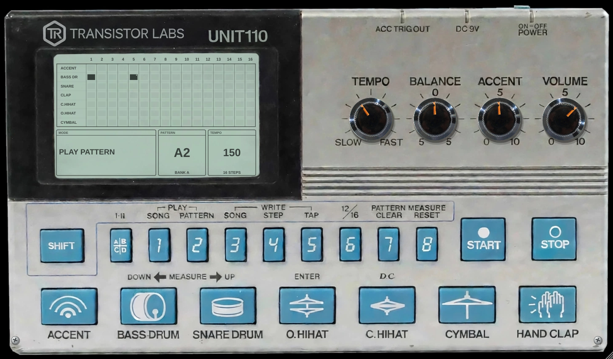

# UNIT 110

Hyperrealistic 110-style rhythm composer by **Transistor Labs**: AU / VST3 / LV2 / Standalone for macOS, Windows and Linux.



Six analog-style voices (bass drum, snare, hand clap, closed hat, open hat, cymbal), a global accent and a 16-step
sequencer with 32 patterns and a song mode, played from a photographed front panel: keys that sink, turning knobs,
a working POWER switch and a live LCD. Click a case screw (bottom corners) to open the unit and reach the service
trimmers for every sound setting.

- Manual: [`docs/UNIT110-Manual.pdf`](docs/UNIT110-Manual.pdf)
- Update history: [`docs/UNIT110-History.pdf`](docs/UNIT110-History.pdf)
- Installers: see [Releases](../../releases)

## Quick reference

| | |
|---|---|
| SHIFT + 1..5 | PLAY SONG · PLAY PATTERN · WRITE SONG · WRITE STEP · WRITE TAP |
| SHIFT + 6 / 7 / 8 | 12 / 16 steps · clear pattern · clear song |
| A\|B\|C\|D | bank of 8 patterns (I-II = steps 9-16 in WRITE STEP) |
| START / STOP | run on the TEMPO knob while the host is stopped |
| LCD | click / drag to edit steps; right-click for MIDI export, copy, clear |
| Drum keys | play; right-click for Mute / Solo / Own output |
| Case screws | open the circuit board with all trimmers |

## Building

Same as TRoss 110: CMake 3.22+, a C++17 compiler; JUCE 8 is downloaded automatically.

```
cmake -B build -DCMAKE_BUILD_TYPE=Release
cmake --build build --config Release
```

GitHub Actions builds every push; pushing a tag `vX.Y.Z` publishes a release with the installers, the manual and the
update history. The UI images in `Assets/` are made from the design renders with `tools/make_assets.py`.
